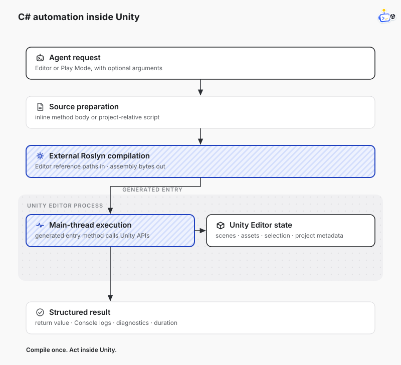

<div align="center">


[中文](./README_ZH.md) · [DotCraft](https://github.com/DotHarness/dotcraft) · [License](./LICENSE)

Unified AI agent integration for Unity Editor—in-editor chat, CLI/MCP automation, and the option to use it without installing the UPM package.

</div>

## What it does

Your agent can run C# in a running Unity Editor, compile scripts and read the errors, and keep track of play mode and reloads, all without installing anything into your project. The optional Unity package adds chat inside the Editor, an MCP Gateway for other coding agents, and your own project-specific tools.

Requires Unity 2021.3 to 6.6 on the Mono runtime. CoreCLR is not supported yet.

## Install

### DotCraft

Open **Plugins**, install **Unity**, then select **Try in chat**.


### Codex

In **Plugins**, choose **Add a marketplace**, enter `DotHarness/dotcraft-unity`, then install **DotCraft Unity**.


### Other agents

Copy [`Plugins/dotcraft-unity/skills/dotcraft-unity`](./Plugins/dotcraft-unity/skills/dotcraft-unity) into your agent's Skills directory, then install the CLI:

```powershell
irm https://github.com/DotHarness/dotcraft-unity/releases/latest/download/install.ps1 | iex
```

### Unity package (optional)

Chat inside the Editor, the MCP Gateway and custom project tools need the Unity package. Open **Window → Package Manager** and add this Git URL:

```text
https://github.com/DotHarness/dotcraft-unity.git?path=/Packages/com.dotcraft.unity
```

See [Using the Unity package](./Documentations/unity-package.md) to set them up.

## Use it

Open your project in Unity, then tell your agent what you want, for example:

> Inspect the current scene, list every root GameObject, and find any objects with missing scripts.



## License

[Apache License 2.0](./LICENSE)
