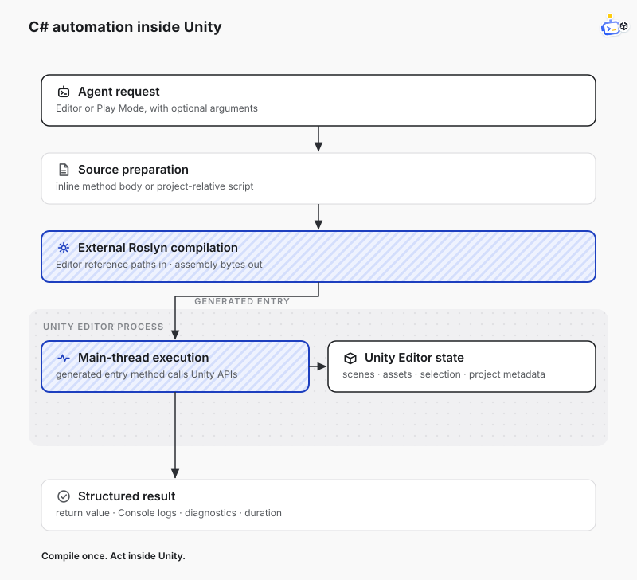

<div align="center">


[English](./README.md) · [DotCraft](https://github.com/DotHarness/dotcraft) · [License](./LICENSE)

面向 Unity Editor 的统一 Agent 集成与自动化。

</div>

## 它能做什么

Agent 可以在运行中的 Unity Editor 里执行 C#，编译脚本并读取错误，随时掌握 Play Mode 和脚本重载状态，而且不需要往项目里安装任何东西。如需在 Editor 内聊天，请安装 [Unity ACP](https://github.com/DotHarness/unity-acp)。

需要 Unity 2021.3 ~ 6.6，并使用 Mono 运行时，暂不支持 CoreCLR。

## 安装

### DotCraft

打开 **Plugins**，安装 **Unity**，然后点击 **Try in chat**。


### Codex

在 **Plugins** 中选择 **Add a marketplace**，输入 `DotHarness/dotcraft-unity`，然后安装 **DotCraft Unity**。


### 其他 Agent

将 [`Plugins/dotcraft-unity/skills/dotcraft-unity`](./Plugins/dotcraft-unity/skills/dotcraft-unity) 复制到 Agent 的 Skills 目录，然后安装 CLI：

```powershell
irm https://github.com/DotHarness/dotcraft-unity/releases/latest/download/install.ps1 | iex
```

## 开始使用

在 Unity 中打开项目，然后告诉 Agent 你想做什么，例如：

> 检查当前场景，列出所有根 GameObject，并找出缺失脚本的对象。



## License

[Apache License 2.0](./LICENSE)
